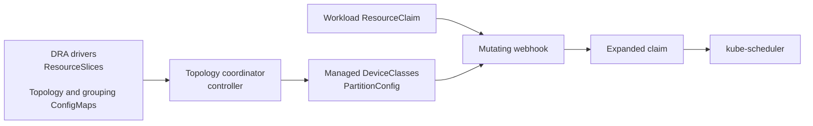

# Node Partition Topology Coordinator

The Node Partition Topology Coordinator is a Kubernetes controller and mutating webhook for [Dynamic Resource Allocation (DRA)](https://kubernetes.io/docs/concepts/scheduling-eviction/dynamic-resource-allocation/). It lets workloads request a logical partition of a node without knowing which DRA drivers, device attributes, or topology constraints provide that partition.

The coordinator does not replace the scheduler or the DRA drivers. It watches the drivers' `ResourceSlice` objects, publishes topology-aware `DeviceClass` objects, and expands partition claims into the individual device requests required by the scheduler.

## How it works



The leader-elected controller:

- reads `ResourceSlice` topology from all DRA drivers;
- computes fixed partitions and administrator-defined device groupings;
- publishes coordinator-managed `DeviceClass` objects with CEL selectors and opaque `PartitionConfig` data; and
- removes stale coordinator-managed `DeviceClass` objects during reconciliation.

The webhook runs on every replica and:

- expands a partition `ResourceClaim` into its driver-specific sub-resource requests;
- adds per-driver topology selectors and any configured `matchAttribute` constraints;
- copies explicitly declared driver configuration for passthrough requests; and
- rewrites Pod and KubeVirt VMI references to the expanded request names.

Ordinary DRA claims that do not reference a coordinator `PartitionConfig` pass through unchanged. No scheduler plugin is required.

The controller cache and webhook run on every replica, but only the elected leader publishes DeviceClasses. Followers refresh topology rules and grouping data locally so equivalent admission requests receive the same expansion regardless of which replica serves them. Losing leadership cancels an in-flight reconciliation before the next leader can publish. The webhook starts only after its local cache is synchronized.

## Partition outputs

The controller publishes `DeviceClass` objects for the topology it discovers. The fixed partition classes are:

| Partition type | Scope |
| --- | --- |
| `pcieroot` | Devices attached to one PCIe root complex, with proportional CPU or memory capacity where available |
| `numa` | Devices grouped within one NUMA topology group |
| `full` | The complete effective device set for a node |

Aggregate classes are also published with names such as `pcieroot`, `numa`, and `full`. When the hardware has a recognizable PCIe-root fraction, the controller may publish tier aliases such as `eighth`, `quarter`, `half`, or `sixth`. These aliases are hardware-dependent; inspect the generated classes before selecting one:

```sh
kubectl get deviceclasses \
  -l nodepartition.dra.k8s.io/managed=true
```

Profile-specific and grouping classes may also be present. DeviceClass names are derived from the participating DRA drivers and topology shape, so they should be discovered from the cluster rather than hard-coded across hardware profiles.

### Default `auto` output

The Helm chart and controller default to `auto`. With devices available, this mode produces the following baseline output where the corresponding topology exists:

| Generated class | When it appears | Notes |
| --- | --- | --- |
| `full` | The topology model has devices for a node | Represents the complete effective device set |
| `pcieroot` | Devices expose PCIe-root topology | Aggregate class for one-root partitions |
| `numa` | More than one NUMA partition is discovered | Aggregate class for NUMA-local partitions |
| `eighth`, `quarter`, `half`, etc. | A fixed partition maps to a recognized PCIe-root fraction | Tier alias; the exact set depends on hardware |
| Profile-specific classes | A concrete driver/topology profile is discovered | Names include driver and topology details |
| Grouping classes | PCIe pairings or grouping ConfigMaps are available | Published alongside fixed partitions in `auto` mode |

Tier aliases are labels on the underlying fixed partition type. For example, a `quarter` class normally has `tierName=quarter` and `partitionType=numa`; the generated labels and `PartitionConfig` are the source of truth for a particular cluster.

## Discover available DeviceClasses

List only the classes managed by the coordinator and include their partition, profile, tier, and coupling labels:

```sh
kubectl get deviceclasses \
  -l nodepartition.dra.k8s.io/managed=true \
  --show-labels
```

You can filter by the generated labels when looking for a particular class:

```sh
kubectl get deviceclasses \
  -l nodepartition.dra.k8s.io/managed=true,nodepartition.dra.k8s.io/tierName=quarter
```

Inspect a candidate class before using it in a `ResourceClaim`:

```sh
kubectl get deviceclass <name> -o yaml
```

The YAML shows the coordinator CEL selector and the opaque `PartitionConfig`, including the underlying DRA device classes, counts, selectors, capacities, and alignment rules.

## Partition modes

The controller accepts `--partition-mode` and the Helm chart exposes the same setting as `partitionMode`:

| Mode | Behavior |
| --- | --- |
| `auto` (default) | Publishes fixed partitions and grouping classes discovered from PCIe pairings or grouping ConfigMaps |
| `partitions` | Publishes fixed `pcieroot`, `numa`, and `full` partition classes only |
| `groupings` | Publishes grouping classes only |

For example:

```sh
helm install nodepartition deploy/helm/nodepartition \
  --set partitionMode=partitions
```

## Requesting a partition

First inspect the generated classes and choose a class available in the target cluster. A partition request looks like this:

```yaml
apiVersion: resource.k8s.io/v1
kind: ResourceClaim
metadata:
  name: accelerator-partition
spec:
  devices:
    requests:
      - name: partition
        exactly:
          deviceClassName: quarter
          count: 1
```

During admission, the webhook expands the partition request into the underlying DRA device classes and adds the selectors and constraints encoded in the class's opaque `PartitionConfig`. The exact expansion depends on the drivers and topology present on the cluster.

## Topology rules

Topology rules are ConfigMaps labeled `nodepartition.dra.k8s.io/topology-rule: "true"`. They map driver-specific attributes to the coordinator's standard topology model and can add claim constraints. The coordinator only reads topology-rule and device-grouping ConfigMaps in its own namespace (`--config-namespace`, default the Helm release namespace), because they control the DeviceClasses it publishes. Set `controller.configNamespace` to use a different namespace, or `controller.watchAllNamespaces=true` to trust every namespace, which lets anyone who can create a labeled ConfigMap publish DeviceClasses.

```yaml
apiVersion: v1
kind: ConfigMap
metadata:
  name: mock-accel-numa-rule
  namespace: nodepartition
  labels:
    nodepartition.dra.k8s.io/topology-rule: "true"
data:
  attribute: mock-accel.example.com/numaNode
  type: int
  driver: mock-accel.example.com
  mapsTo: numaNode
  partitioning: group
  constraint: match
  enforcement: required
```

Apply a device-grouping example in the namespace selected by `controller.configNamespace` (the Helm release namespace by default):

```sh
kubectl -n nodepartition apply -f examples/intent-workload-gpu-inference.yaml
```

Set `controller.watchAllNamespaces=true` only when the broader ConfigMap trust boundary is intentional; any namespace that can create a labeled ConfigMap can then influence the published catalog.

Rule fields:

| Field | Required | Values | Purpose |
| --- | --- | --- | --- |
| `attribute` | yes | Qualified attribute name | Attribute published by the driver |
| `type` | yes | `int`, `string`, `bool` | Attribute value type |
| `driver` | yes | DRA driver name | Driver that owns the attribute |
| `mapsTo` | no | `numaNode`, `pcieRoot`, `socket` | Standard topology attribute used for grouping |
| `partitioning` | no | `group`, `info` | Whether equal values form separate partition groups; defaults to `info` |
| `constraint` | no | `match`, `none` | Whether matching devices are constrained in expanded claims; defaults to `none` |
| `enforcement` | no | `required`, `preferred` | Whether a match constraint is hard or best-effort; defaults to `required` |
| `fallbackAttribute` | no | Qualified attribute name | Looser attribute to use when the primary match cannot be satisfied |
| `deviceClass` | no | DeviceClass name | Overrides the driver's default class name for generated sub-requests |
| `description` | no | Free-form text | Human-readable rule description |

The coordinator supplies a built-in `resource.kubernetes.io/pcieRoot` match rule with NUMA fallback unless an explicit PCIe-root match rule is configured. Driver-specific NUMA rules still generate per-driver CEL selectors, because different drivers may use different attribute names.

`preferred` constraints are emitted only when the topology model can satisfy them. A `required` constraint is retained even when no placement can satisfy it, so the workload remains unschedulable instead of silently losing the requested alignment.

## Device groupings

Device groupings describe a named combination of DRA device classes that should be co-located. They are ConfigMaps labeled `nodepartition.dra.k8s.io/device-grouping: "true"`:

```yaml
apiVersion: v1
kind: ConfigMap
metadata:
  name: gpu-nic-pair
  namespace: nodepartition
  labels:
    nodepartition.dra.k8s.io/device-grouping: "true"
data:
  name: gpu-nic-pair
  rail: "true"
  alignment: pcieRoot
  devices: |
    - class: gpu.example.com
      count: 1
    - class: rdma.example.com
      count: 1
```

`alignment` and `fallback` accept `pcieRoot`, `numaNode`, or `socket`. Device entries require `class` and a positive `count`; each entry may also provide a `capacity` map for consumable DRA capacity. Set `rail: "true"` only for an explicit GPU+NIC offering that must be satisfied on one PCIe root. Rail offerings must use `pcieRoot` alignment without a fallback and exactly two device entries with `count: 1`; the coordinator treats the device classes as the operator-declared GPU and NIC pair and does not infer rail intent from class names.

`alignment` is the preferred co-location level. `fallback` is opt-in: it evaluates remaining devices at a looser level and publishes separate fallback instances; it is never added automatically and it does not stack a NUMA constraint on top of a PCIe-root class. An aggregate grouping preserves one alignment level without pinning a particular value, so `alignment: numaNode` means all expanded requests must share one NUMA node while the scheduler chooses which node. If a grouping produces both preferred and fallback instances, the aggregate does not encode both alternatives; select a topology-specific class when the alignment choice matters.

Keys inside `devices` are matched strictly: an unknown or duplicate key (for example `passthru:` instead of `passthrough:`) rejects the ConfigMap with an error naming the key. Matching stays case-insensitive, so `Class:` is still accepted. Unknown top-level `data` keys are ignored with a warning. A ConfigMap rejected on initial load is absent from the grouping store, so its DeviceClasses are removed on the next reconcile; an invalid update keeps the last valid cached grouping until the update is corrected. Before upgrading, check every `devices:` block for keys outside the supported set: `class`, `requestClass`, `count`, `capacity`, `passthrough`, `selectors`, and `opaque`.

Managed DeviceClasses carry a versioned `PartitionConfig` (`apiVersion: nodepartition.dra.k8s.io/v1alpha1`). The webhook denies claims against a managed class whose `apiVersion` it does not support, or whose config has fields it does not know, instead of expanding the claim without them. Classes published before versioning have no `apiVersion` and are still accepted until the next reconcile rewrites them. Strict decoding only protects webhooks that already include it, so during a rolling update from an older release the old pods still ignore unknown fields.

The aggregate DeviceClass keeps the grouping name. Explicit rail instances are named `<grouping>-rail<N>` and carry the `railIndex` label. Ordinary grouping instances retain their locality meaning in the name, such as `<grouping>-numa<N>`, `<grouping>-pcie-<root>`, or `<grouping>-socket<N>`, and do not carry `railIndex`. Fixed PCIe partition classes use their PCIe-root name directly and also do not use `railIndex`. This is a breaking rename for previously generated non-rail and fixed-partition `-rail<N>` classes. During an upgrade, the coordinator pauses publication while those legacy classes exist; remove the legacy classes (or uninstall/reinstall the release), update claims to the new topology-specific names, then resume reconciliation.

All DeviceClasses are cluster-scoped. A topology-specific name describes a repeatable shape, not a node identity. When matching instances coalesce to one published name, the coordinator adds a `nodepartition.dra.k8s.io/count` label; that label is catalog metadata, not a DRA capacity field. Requesting such a class lets the scheduler choose any matching node; use Pod or VMI node affinity/selection when placement on a particular node is required. The grouping-wide aggregate has no fixed rail or locality value and is scheduler-placed across every satisfiable instance.

For an aggregate `alignment: numaNode` grouping, every participating device must expose the scalar NUMA attribute needed to build one `matchAttribute` constraint. If a driver publishes only list-valued NUMA attributes, the coordinator keeps the topology-specific classes but may omit the grouping-wide NUMA aggregate.

Passthrough devices must declare their VFIO contract explicitly: set `requestClass`, `selectors`, or `opaque` on every device with `passthrough: true`, otherwise the ConfigMap is rejected. The coordinator no longer injects VFIO configuration from driver names, so existing passthrough ConfigMaps must be updated before VMs using them restart. If `requestClass` is served by a different driver than `class`, also set `requestDriver` (see below); otherwise the generated NUMA selector uses the attribute namespace of the driver that publishes `class`.

Grouping offerings default to `mode: container`, which keeps ordinary Pod claims free of VM passthrough configuration. Set `mode: passthrough` and mark only the physical devices that should be exposed to a VM:

```yaml
data:
  name: amd-gim-gpu-nic-vfio
  mode: passthrough
  alignment: pcieRoot
  devices: |
    - class: gpu.amd.com
      requestClass: gpu.amd.com
      selectors:
        - 'device.attributes["gpu.amd.com"].type == "vfio"'
        - 'device.attributes["gpu.amd.com"].isVF == true'
      count: 1
      passthrough: true
    - class: sriovnetwork.k8snetworkplumbingwg.io
      requestClass: sriovnetwork.k8snetworkplumbingwg.io
      count: 1
      passthrough: true
      opaque:
        driver: sriovnetwork.k8snetworkplumbingwg.io
        parameters:
          apiVersion: sriovnetwork.k8snetworkplumbingwg.io/v1alpha1
          kind: VfConfig
          driver: vfio-pci
```

`class` identifies the topology class used to find compatible devices. `requestClass` optionally selects a different driver-owned DeviceClass in the expanded claim; it defaults to `class`. `selectors` are copied to that sub-request, and `opaque` is copied unchanged to the matching request configuration. The coordinator does not interpret opaque parameters or infer VFIO from a class name.

`requestDriver` (optional, requires `requestClass`) names the driver whose devices `requestClass` allocates. Set it when that driver differs from the one that publishes `class`:

- The NUMA selector on the generated request uses `requestDriver`'s NUMA attribute. That attribute comes from a topology rule with `mapsTo: numaNode` for `requestDriver`, and the standard `resource.kubernetes.io/numaNode` is used when there is no such rule. Adding a rule for `requestDriver` can also affect automatic partitions and which DeviceClass is chosen for that driver.
- A request is left out of an alignment unless its attribute is a standard `resource.kubernetes.io/` attribute (which describes the physical device) or belongs to `requestDriver`'s own domain, because `matchAttribute` cannot be satisfied if an allocated device lacks the attribute. If fewer than two requests remain, the alignment is dropped.
- When `opaque` is set, `opaque.driver` must equal `requestDriver`.
- An older controller ignores `requestDriver` and builds the selector from the source driver.

```yaml
devices: |
  - class: gpu.example.com
    requestClass: gpu-vfio.example.com
    requestDriver: vfio.example.com
    count: 1
    passthrough: true
```

For an NVMe passthrough offering, keep topology discovery on `dra.nvme` but request the driver's VFIO class:

```yaml
devices: |
  - class: dra.nvme
    requestClass: dra.nvme-vfio
    count: 1
    passthrough: true
```

The `passthrough` flag controls VM-oriented request splitting and KubeVirt host-device mapping. Actual binding, CDI creation, and cleanup remain responsibilities of the selected DRA driver.

The coordinator's passthrough fields are generic; the selected driver still defines the actual VFIO contract. Common integration shapes are:

| Integration | Coordinator-side declaration | Driver-owned responsibility |
| --- | --- | --- |
| NVIDIA standalone GPU | Request the driver's VFIO DeviceClass (for example `vfio.gpu.nvidia.com`) and any driver-defined selectors | GPU VFIO preparation, CDI/device injection, and restore |
| AMD GIM/VFIO path | Request the VFIO-capable class published by the AMD driver and use its documented selectors (for example a `type: vfio`/VF selector) | GIM/VFIO binding and guest device setup; do not infer this from an `amdgpu` class name |
| SR-IOV | Use the SR-IOV driver's request class and copy its documented `VfConfig` opaque payload, such as `driver: vfio-pci` when that driver requires it | VF configuration, NAD/runtime integration, VFIO binding, and cleanup |
| NVMe passthrough | Discover topology through `dra.nvme` but request the driver's VFIO class (for example `dra.nvme-vfio`) | NVMe rebind/unbind, guest exposure, and return to the normal driver |

These names are examples, not coordinator-wide defaults. Inspect the installed driver's DeviceClasses and claim contract before creating a grouping. If a driver has separate `amdgpu`, GIM, or VFIO offerings, select the exact class and selectors for the desired runtime path.

For a passthrough sub-resource with `count > 1` and no consumable capacity, the webhook creates separate `count: 1` requests so KubeVirt can map each physical device to a unique host device. Capacity-backed sub-resources keep their count and capacity request because they represent shared capacity rather than individually passed-through devices.

For KubeVirt, reference a passthrough grouping from a `ResourceClaimTemplate` in the VMI's `resourceClaims` list. The webhook resolves the template before Kubernetes creates its generated claim, expands the declared requests, creates host-device entries only for explicitly marked passthrough sub-resources, and rewrites existing `requestName` fields when needed. A container-mode offering remains a normal DRA request and never causes implicit VFIO binding.

```yaml
data:
  name: nvidia-gpu-nic-vfio
  mode: passthrough
  alignment: pcieRoot
  devices: |
    - class: gpu.nvidia.com
      requestClass: vfio.gpu.nvidia.com
      count: 2
      passthrough: true
    - class: rdma.mellanox.com
      requestClass: rdma.mellanox.com
      count: 2
      passthrough: true
```

Automatically generated partition classes remain container offerings. Passthrough configuration is copied only when it is explicitly declared on the grouping sub-resource; the webhook never synthesizes a driver configuration from a name.

### Intent-based offerings

Grouping ConfigMaps may include these optional keys in `data` to describe an offering for discovery:

| Key | Accepted values | Published metadata |
| --- | --- | --- |
| `displayName` | Up to 63 Unicode code points | `nodepartition.dra.k8s.io/display-name` annotation |
| `description` | Up to 1024 Unicode code points | `nodepartition.dra.k8s.io/description` annotation |
| `intentLevel` | `workload`, `capability`, or `hardware-specific` | `nodepartition.dra.k8s.io/intent-level` label |
| `categories` | Comma-separated list | `nodepartition.dra.k8s.io/categories` annotation |
| `workloadTypes` | Comma-separated list | `nodepartition.dra.k8s.io/workload-types` annotation |
| `visibility` | `public` or `internal` | `nodepartition.dra.k8s.io/visibility` label |
| `offering` | `true` or `false` | `nodepartition.dra.k8s.io/offering` label on the aggregate class |

All seven metadata keys are optional, so valid existing grouping ConfigMaps need no metadata changes. The required `data.name` must sanitize to a DNS-1123 label of at most 56 characters; validation may reject older invalid or overlong names. The 63-code-point `displayName` cap and 1024-code-point `description` cap are project policies, not Kubernetes API limits. `categories` and `workloadTypes` are split on commas, trimmed, emptied values dropped, and duplicates removed while retaining first-seen order. Each list accepts at most 16 unique entries of at most 63 Unicode code points; the published annotation joins those entries with commas.

Intent labels and annotations appear on aggregate DeviceClasses for user-defined groupings. Per-instance and auto-detected grouping classes do not receive intent metadata. `visibility` is published only when explicitly set. Discover matching classes with labels:

```sh
kubectl get deviceclasses -l nodepartition.dra.k8s.io/intent-level=workload
kubectl get deviceclasses -l nodepartition.dra.k8s.io/visibility=public
kubectl get deviceclasses -l nodepartition.dra.k8s.io/visibility=public \
  -o custom-columns='NAME:.metadata.name,LEVEL:.metadata.labels.nodepartition\.dra\.k8s\.io/intent-level,DISPLAY:.metadata.annotations.nodepartition\.dra\.k8s\.io/display-name'
```

Every grouping DeviceClass also carries `nodepartition.dra.k8s.io/mode` (`container` or `passthrough`) and `nodepartition.dra.k8s.io/source` (`configmap` or `auto`). Aggregate classes carry `nodepartition.dra.k8s.io/aggregate=true`. The `offering` label is set only from the explicit `offering: "true"` key; it is never inferred from other metadata, and it marks the class as a stable request target.

`nodepartitionctl` lists the same information without label selectors. It needs `get` and `list` on `deviceclasses`:

```sh
nodepartitionctl offerings list            # curated offerings only
nodepartitionctl offerings list --all      # plus grouping, auto-detected, and partition classes
nodepartitionctl offerings get gpu-inference -o json
nodepartitionctl offerings get gpu-inference-rail0 -o json
nodepartitionctl offerings explain gpu-inference
nodepartitionctl offerings explain gpu-inference -o json
```

Entries have a `kind`: `offering` (aggregate class with `offering=true`), `grouping` (any other ConfigMap grouping), `auto-detected` (coordinator-derived PCIe pairing), or `partition` (fixed-hierarchy class). Per-instance classes appear as `variants` of their aggregate. Output never includes class selectors or opaque driver configuration. Names of `grouping`, `auto-detected`, and `partition` entries can change with topology, so only `offering` entries are stable request targets.

Enable shell completion with the generated Cobra script:

```sh
echo 'source <(nodepartitionctl completion bash)' >> ~/.bashrc
source ~/.bashrc
```

`offerings get NAME` and `offerings explain NAME` dynamically complete managed catalog and topology-specific variant names from the cluster. Completion only needs the current kubeconfig identity to have `list` access to the cluster-scoped `deviceclasses` resource. It is bounded to a short timeout, so an unavailable API server returns no names instead of blocking the shell. Variants are useful when a workload needs a particular topology shape, but their names can change after reconciliation.

`offerings explain NAME` shows the normalized request contract for a managed DeviceClass: its kind, mode, topology level, placement, source driver, requested device class, count, capacity request, VM passthrough flag, GPU partition profile, and configured alignment rules. For grouping classes, the topology level comes from the configured `alignment`; for fixed partition classes it is derived from `partitionType` (`numa` → `numaNode`, `pcieroot` → `pcieRoot`, and `full` → `node`). Aggregate classes report `scheduler-selected` placement, while topology-specific variants report their concrete NUMA, PCIe-root, or rail label. It validates the embedded `PartitionConfig` and intentionally omits raw CEL selectors and opaque driver parameters. Use `-o json` when another tool needs to consume the contract; JSON field names remain stable (`mode`, `alignment`, and `partitionMode`), with `placement` identifying the selected or scheduler-chosen topology value.

`categories` and `workloadTypes` are comma-joined annotations, so Kubernetes label selectors cannot query those values. Intent metadata currently supports discovery and cataloging only; request-level claim rejection based on categories or workload types is deferred, and the webhook expands claims from the DeviceClass scheduling configuration independently of these annotations.

If a grouping ConfigMap update is invalid, the coordinator retains the last valid cached grouping and logs that its metadata may be stale until a valid update arrives. If distinct `data.name` values sanitize to the same DeviceClass name, or their emitted aggregate/per-instance names overlap (for example, an explicit `gpu` rail emits `gpu-rail0` while another grouping's aggregate is `gpu-rail0`), grouping publication pauses to preserve the last successfully published classes; other grouping updates wait until the conflict is corrected. Two ConfigMaps that define the same `data.name` pause publication the same way, so an offering name always has one owner. A grouping class never overwrites a partition class with the same name, or the reverse; the publish fails instead.

Example ConfigMaps:

- [GPU inference workload](examples/intent-workload-gpu-inference.yaml)
- [Low-latency network capability](examples/intent-capability-low-latency-network.yaml)
- [GPU and NIC hardware alignment](examples/intent-hardware-gpu-nic-aligned.yaml)

## Driver requirements

The coordinator can work with any DRA driver that publishes usable topology information in `ResourceSlice` objects. For topology-aware partitions, configure rules for the driver-specific NUMA, PCIe-root, socket, or other attributes that the cluster exposes.

The repository's E2E workflow exercises:

- [mock-device](https://github.com/fabiendupont/mock-device) as the required mock accelerator driver; and
- [dra-driver-cpu](https://github.com/kubernetes-sigs/dra-driver-cpu) as an optional CPU driver in individual mode; it is required by the E2E `cross-driver` profile.

The separate `k8s-dra-harness` integration can use its
hardware-free `example` adapter or real CPU, GPU, and SR-IOV adapters. The direct
E2E suite and the harness bridge are complementary: the former exercises the
repository's full live test package, while the latter coordinates driver/runtime
validation and preserves shared evidence and cleanup boundaries.

Other drivers require their actual `ResourceSlice` driver names, DeviceClass names, attribute types, and topology attributes to be configured in rules. The coordinator does not assume a universal vendor attribute naming scheme.

## Prerequisites

- Kubernetes 1.34 or newer with DRA enabled;
- Go 1.25 or newer for local development;
- `kubectl` and Helm for cluster installation; and
- cert-manager, an OpenShift serving-certificate controller, or a manually provisioned webhook certificate, depending on the selected TLS mode.

Optional features have their own cluster prerequisites:

| Feature | Required when | Gate or dependency |
| --- | --- | --- |
| Consumable capacity | A grouping or partition requests `capacity` | Kubernetes `DRAConsumableCapacity` |
| List-valued attributes | A driver publishes list-valued DRA attributes | Kubernetes `DRAListTypeAttributes`; scalar topology rules remain the portable default |
| Node allocatable accounting | Node-level DRA CPU/memory accounting is consumed | Kubernetes `DRANodeAllocatableResources` |
| KubeVirt host devices | A VMI consumes a passthrough grouping | KubeVirt/OpenShift Virtualization and the feature gate required by the selected device type |

The coordinator does not enable cluster or KubeVirt feature gates. Verify the gate state and driver/runtime prerequisites before using capacity, list-valued attributes, or VM passthrough.

The Helm chart declares a default cert-manager issuer of `selfsigned-issuer` but does not create that issuer. Create or configure an issuer before installing with the default TLS mode.

## Build and test

```sh
make build          # bin/nodepartition-controller
make setup-envtest  # download Kubernetes 1.34 envtest assets
make test           # unit, integration, and property tests
make test-coverage
make lint
```

`make test` obtains the envtest assets automatically when they are not already available. `make dev` runs dependency download, formatting, vet, lint, tests, and build.

Build the container image with:

```sh
docker build -t nodepartition-controller:dev .
```

The Dockerfile uses a Go 1.26 builder image and produces a non-root distroless image. The Helm chart's default image repository and tag can be overridden with `controller.image.repository` and `controller.image.tag`. A source checkout does not publish an image automatically, so use the local-image override below when installing from source.

Tagged releases also publish `nodepartitionctl` archives for Linux `amd64` and `arm64` on the GitHub Release page. Download the archive for your host, verify it with `checksums.txt`, and place the extracted binary on your `PATH`:

```sh
VERSION=0.1.0
ARCH=amd64 # use arm64 on aarch64 hosts
curl -LO "https://github.com/rh-ecosystem-edge/k8s-dra-topology-coordinator/releases/download/v${VERSION}/nodepartitionctl-${VERSION}-linux-${ARCH}.tar.gz"
curl -LO "https://github.com/rh-ecosystem-edge/k8s-dra-topology-coordinator/releases/download/v${VERSION}/checksums.txt"
sha256sum -c checksums.txt --ignore-missing
tar -xzf "nodepartitionctl-${VERSION}-linux-${ARCH}.tar.gz"
mkdir -p ~/.local/bin
install -m 0755 nodepartitionctl ~/.local/bin/nodepartitionctl
```

## Helm installation

```sh
helm install nodepartition deploy/helm/nodepartition \
  --namespace nodepartition \
  --create-namespace
```

For a tagged release, install the chart from GHCR instead:

```sh
helm install nodepartition oci://ghcr.io/rh-ecosystem-edge/charts/nodepartition \
  --version <release-version> \
  --namespace nodepartition \
  --create-namespace
```

To use a locally built or privately published image:

```sh
helm install nodepartition deploy/helm/nodepartition \
  --namespace nodepartition \
  --create-namespace \
  --set controller.image.repository=nodepartition-controller \
  --set controller.image.tag=dev \
  --set controller.image.pullPolicy=IfNotPresent
```

The chart installs a cluster-scoped controller with leader election, RBAC for DRA resources, a webhook Service, and mutating webhook rules for ResourceClaims. Pod and KubeVirt VMI admission rules are best-effort (`failurePolicy: Ignore`); ResourceClaim admission fails closed (`failurePolicy: Fail`).

### Webhook TLS

The webhook listens on port `9443` and requires the TLS Secret named `<release-fullname>-webhook-tls`:

| Mode | Value | Requirement |
| --- | --- | --- |
| cert-manager | `controller.webhook.tls.mode=cert-manager` | A matching `Issuer` or `ClusterIssuer` already exists; the chart creates a `Certificate` |
| OpenShift | `controller.webhook.tls.mode=openshift` | OpenShift service-serving certificate injection is available |
| Manual | `controller.webhook.tls.mode=manual` | Create the expected Secret and set `controller.webhook.tls.caBundle` |

See [`deploy/helm/nodepartition/values.yaml`](deploy/helm/nodepartition/values.yaml) for all chart values.

After installation, check the deployment, webhook Service, and generated classes:

```sh
kubectl -n nodepartition rollout status deployment/nodepartition-controller
kubectl -n nodepartition get service
kubectl get deviceclasses -l nodepartition.dra.k8s.io/managed=true
```

## Observability

The controller exposes health and Prometheus endpoints on port `8081`:

```sh
kubectl -n nodepartition port-forward deployment/nodepartition-controller 8081:8081
curl http://127.0.0.1:8081/healthz
curl http://127.0.0.1:8081/metrics
```

Port `8081` serves `/metrics` unauthenticated over plain HTTP. Set `controller.metrics.enabled=false` to disable it.

The registered controller metrics are:

| Metric | Type | Description |
| --- | --- | --- |
| `nodepartition_controller_reconciliation_duration_seconds` | Histogram | Reconciliation duration |
| `nodepartition_controller_reconciliation_errors_total` | Counter | Reconciliation errors |
| `nodepartition_controller_nodes_total` | Gauge | Nodes represented in the current topology result |
| `nodepartition_controller_deviceclasses_total` | Gauge | Managed partition and grouping DeviceClasses |
| `nodepartition_controller_topology_rules_total` | Gauge | Active topology rules |
| `nodepartition_webhook_expansions_total` | Counter | Partition claims expanded by the webhook |
| `nodepartition_webhook_errors_total` | Counter | Webhook expansion or admission errors |

## Security notes

The webhook port (`controller.webhook.port`) must be reachable only by the Kubernetes API server. The handlers trust the namespace and name in the AdmissionReview and cannot authenticate callers without client certificates, so restrict access with the chart NetworkPolicy (`controller.networkPolicy.enabled=true`).

The controller fails startup when the webhook certificate or key cannot be loaded, because a missing listener would otherwise block ResourceClaim admission. ResourceClaim webhook transport failures use `failurePolicy: Fail`; Pod and VMI transport failures use `failurePolicy: Ignore`, while the handlers still reject missing or malformed managed templates and expansion contracts.

`driverName` is the configured DRA identity in generated selectors and opaque configuration. Coordinator labels, annotations, and the `PartitionConfig` API version continue to use the fixed `nodepartition.dra.k8s.io` metadata prefix. DeviceClass names are not scoped to a release: two releases with different `--driver-name` values in one cluster still collide on same-named DeviceClasses. Changing `--driver-name` also leaves the old driver's classes undeleted; remove them manually before installing under the new identity. The controller refuses to overwrite a same-named DeviceClass that is not coordinator-managed, but two coordinator releases still require unique names and an explicit migration plan.

## End-to-end testing

See [`test/e2e/README.md`](test/e2e/README.md) for the disposable-cluster contract,
profile selection, TLS settings, and validation with mock-device and dra-driver-cpu.
Run `E2E_KUBECONFIG=/path/to/kubeconfig E2E_DISPOSABLE_CLUSTER=1 make e2e` only
against a cluster dedicated to the test run.

For harness-driven validation, see [`test/e2e/harness/README.md`](test/e2e/harness/README.md)
and the full [`docs/harness-test-plan.md`](docs/harness-test-plan.md). The bridge
lets `k8s-dra-harness` own drivers and workloads while this repository owns the
coordinator release, supplied grouping/rule fixtures, catalog smoke evidence,
and cleanup. The current bridge does not yet run allocation or VFIO assertions;
synthetic ResourceSlices validate catalog publication, while admission coverage
comes from the direct suite or future bridge probes and real VFIO binding still
requires the hardware-driver lane.

## Contributing

```sh
make dev
```

Create a feature branch, run the development checks, and submit a pull request. Commits should include a `Signed-off-by` line (`git commit -s`).

## License

Apache 2.0 — see [`LICENSE.header`](LICENSE.header).
