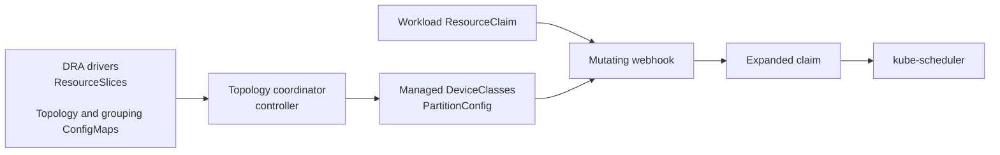

# Node Partition Topology Coordinator

The Node Partition Topology Coordinator is a Kubernetes controller and mutating webhook for [Dynamic Resource Allocation (DRA)](https://kubernetes.io/docs/concepts/scheduling-eviction/dynamic-resource-allocation/). It lets workloads request a logical partition of a node without knowing which DRA drivers, device attributes, or topology constraints provide that partition.

The coordinator does not replace the scheduler or the DRA drivers. It watches the drivers' `ResourceSlice` objects, publishes topology-aware `DeviceClass` objects, and expands partition claims into the individual device requests required by the scheduler.

## How it works



The leader-elected controller:

- reads `ResourceSlice` topology from all DRA drivers;
- computes fixed partitions and administrator-defined device groupings;
- publishes coordinator-managed `DeviceClass` objects with CEL selectors and opaque `PartitionConfig` data; and
- removes stale coordinator-managed `DeviceClass` objects during reconciliation.

The webhook runs on every replica and:

- expands a partition `ResourceClaim` into its driver-specific sub-resource requests;
- adds per-driver topology selectors and any configured `matchAttribute` constraints;
- copies explicitly declared driver configuration for passthrough requests; and
- rewrites Pod and KubeVirt VMI references to the expanded request names.

Ordinary DRA claims that do not reference a coordinator `PartitionConfig` pass through unchanged. No scheduler plugin is required.

The controller cache and webhook run on every replica, but only the elected leader publishes DeviceClasses. Followers refresh topology rules and grouping data locally so equivalent admission requests receive the same expansion regardless of which replica serves them. Losing leadership cancels an in-flight reconciliation before the next leader can publish. The webhook starts only after its local cache is synchronized.

## Partition outputs

The controller publishes `DeviceClass` objects for the topology it discovers. The fixed partition classes are:

| Partition type | Scope |
| --- | --- |
| `pcieroot` | Devices attached to one PCIe root complex, with proportional CPU or memory capacity where available |
| `numa` | Devices grouped within one NUMA topology group |
| `full` | The complete effective device set for a node |

Aggregate classes are also published with names such as `pcieroot`, `numa`, and `full`. When the hardware has a recognizable PCIe-root fraction, the controller may publish tier aliases such as `eighth`, `quarter`, `half`, or `sixth`. These aliases are hardware-dependent; inspect the generated classes before selecting one:

```sh
kubectl get deviceclasses \
  -l nodepartition.dra.k8s.io/managed=true
```

Profile-specific and grouping classes may also be present. DeviceClass names are derived from the participating DRA drivers and topology shape, so they should be discovered from the cluster rather than hard-coded across hardware profiles.

### Default `auto` output

The Helm chart and controller default to `auto`. With devices available, this mode produces the following baseline output where the corresponding topology exists:

| Generated class | When it appears | Notes |
| --- | --- | --- |
| `full` | The topology model has devices for a node | Represents the complete effective device set |
| `pcieroot` | Devices expose PCIe-root topology | Aggregate class for one-root partitions |
| `numa` | More than one NUMA partition is discovered | Aggregate class for NUMA-local partitions |
| `eighth`, `quarter`, `half`, etc. | A fixed partition maps to a recognized PCIe-root fraction | Tier alias; the exact set depends on hardware |
| Profile-specific classes | A concrete driver/topology profile is discovered | Names include driver and topology details |
| Grouping classes | PCIe pairings or grouping ConfigMaps are available | Published alongside fixed partitions in `auto` mode |

Tier aliases are labels on the underlying fixed partition type. For example, a `quarter` class normally has `tierName=quarter` and `partitionType=numa`; the generated labels and `PartitionConfig` are the source of truth for a particular cluster.

## Discover available DeviceClasses

List only the classes managed by the coordinator and include their partition, profile, tier, and coupling labels:

```sh
kubectl get deviceclasses \
  -l nodepartition.dra.k8s.io/managed=true \
  --show-labels
```

You can filter by the generated labels when looking for a particular class:

```sh
kubectl get deviceclasses \
  -l nodepartition.dra.k8s.io/managed=true,nodepartition.dra.k8s.io/tierName=quarter
```

Inspect a candidate class before using it in a `ResourceClaim`:

```sh
kubectl get deviceclass <name> -o yaml
```

The YAML shows the coordinator CEL selector and the opaque `PartitionConfig`, including the underlying DRA device classes, counts, selectors, capacities, and alignment rules.

## Partition modes

The controller accepts `--partition-mode` and the Helm chart exposes the same setting as `partitionMode`:

| Mode | Behavior |
| --- | --- |
| `auto` (default) | Publishes fixed partitions and grouping classes discovered from PCIe pairings or grouping ConfigMaps |
| `partitions` | Publishes fixed `pcieroot`, `numa`, and `full` partition classes only |
| `groupings` | Publishes grouping classes only |

Grouping ConfigMaps are read only from the trusted config namespace; see [Configuring the coordinator](#configuring-the-coordinator).

For example:

```sh
helm install nodepartition deploy/helm/nodepartition \
  --set partitionMode=partitions
```

## Requesting a partition

First inspect the generated classes and choose a class available in the target cluster. A partition request looks like this:

```yaml
apiVersion: resource.k8s.io/v1
kind: ResourceClaim
metadata:
  name: accelerator-partition
spec:
  devices:
    requests:
      - name: partition
        exactly:
          deviceClassName: quarter
          count: 1
```

During admission, the webhook expands the partition request into the underlying DRA device classes and adds the selectors and constraints encoded in the class's opaque `PartitionConfig`. The exact expansion depends on the drivers and topology present on the cluster.

## Configuring the coordinator

The coordinator is configured with two optional kinds of ConfigMap. Both must be labeled and live in the trusted config namespace.

| | Topology rule | Device grouping |
| --- | --- | --- |
| Label | `nodepartition.dra.k8s.io/topology-rule: "true"` | `nodepartition.dra.k8s.io/device-grouping: "true"` |
| Purpose | Teach the coordinator how to read one driver attribute (NUMA node, PCIe root, socket) and whether to constrain on it | Define a named bundle of device classes that must be co-located, published as an offering |
| Typical author | Cluster admin integrating a DRA driver | Platform admin curating workload-facing offerings |
| Read in `partitionMode` | all modes | `auto` and `groupings` only |

Start with no ConfigMaps, inspect the generated classes, add rules if devices are missing or unaligned, and add groupings for named offerings. Full field reference, validation, passthrough, rails, and upgrade notes are in [`docs/configuration.md`](docs/configuration.md).

**Trust boundary.** The coordinator reads these ConfigMaps only from `--config-namespace` (binary default `$POD_NAMESPACE`; Helm default the release namespace; override with `controller.configNamespace`). `controller.watchAllNamespaces=true` trusts every namespace, which lets anyone who can create a labeled ConfigMap publish DeviceClasses.

A topology rule:

```yaml
apiVersion: v1
kind: ConfigMap
metadata:
  name: mock-accel-numa-rule
  namespace: nodepartition
  labels:
    nodepartition.dra.k8s.io/topology-rule: "true"
data:
  attribute: mock-accel.example.com/numaNode
  type: int
  driver: mock-accel.example.com
  mapsTo: numaNode
  partitioning: group
  constraint: match
  enforcement: required
```

A device grouping (apply it in the config namespace):

```yaml
apiVersion: v1
kind: ConfigMap
metadata:
  name: gpu-nic-pair
  namespace: nodepartition
  labels:
    nodepartition.dra.k8s.io/device-grouping: "true"
data:
  name: gpu-nic-pair
  rail: "true"
  alignment: pcieRoot
  offering: "true"
  devices: |
    - class: gpu.example.com
      count: 1
    - class: rdma.example.com
      count: 1
```

Ready-to-apply groupings are in [`examples/`](examples/); a larger real-world set (capacity, rail, passthrough) is in [`demos/topology-coordinator-admin-debug/configmaps.yaml`](demos/topology-coordinator-admin-debug/configmaps.yaml). See also the [demos](demos/README.md).

## DeviceClass labels and annotations

All keys use the fixed prefix `nodepartition.dra.k8s.io/`.

| Key | Kind | Meaning |
| --- | --- | --- |
| `managed` | label | `true` on every coordinator-managed DeviceClass |
| `partitionType` | label | `pcieroot`, `numa`, or `full` for fixed partitions |
| `profile` | label | Driver/topology profile of a fixed partition |
| `tierName` | label | Fraction alias such as `quarter` |
| `count` | label | Number of matching instances coalesced into this name |
| `grouping` | label | Grouping name |
| `aggregate` | label | `true` on the grouping-wide class |
| `alignment` | label | Alignment level of a grouping class |
| `numa`, `pcieRoot`, `railIndex` | label | Topology-specific instance values |
| `coupling` | label | Coupling of the partition's constraints |
| `mode` | label | `container` or `passthrough` |
| `source` | label | `configmap` or `auto` |
| `offering` | label | `true` only when the grouping sets `offering: "true"` |
| `intent-level`, `visibility` | label | From grouping intent metadata |
| `display-name`, `description`, `categories`, `workload-types` | annotation | From grouping intent metadata |
| `expanded-requests` | annotation on expanded claims | Mapping from original to expanded request names, written by the webhook |

## Discover offerings and preview claims with dratopoctl

`dratopoctl` accepts `--kubeconfig` and `--context` on every command. Catalog commands support `-o table|json` and need `list` access to `deviceclasses`.

```sh
dratopoctl offerings list            # curated offerings only
dratopoctl offerings list --all      # plus grouping, auto-detected, and partition classes
dratopoctl offerings get gpu-inference -o json
dratopoctl offerings get gpu-inference-rail0 -o json
dratopoctl offerings explain gpu-inference
dratopoctl offerings explain gpu-inference -o json
```

Preview the exact ResourceClaim returned by webhook admission before saving it:

```sh
dratopoctl claims expand -f claim.yaml
dratopoctl claims expand -f resourceclaim-template.yaml -n default
kubectl get resourceclaimtemplate my-template -o yaml | dratopoctl claims expand -f -
dratopoctl claims expand --offering gpu-inference
dratopoctl claims expand --offering gpu-inference --count 3
```

`claims expand` accepts either one `resource.k8s.io/v1` ResourceClaim or ResourceClaimTemplate in a YAML or JSON file (or stdin), or one curated offering with `--offering`; other YAML documents such as a Pod are ignored. `--count` defaults to 1 and sets the number of complete offering bundles requested, not the number of sub-devices or the catalog's current `Count`. It is valid only with `--offering`. The shortcut checks that the name is a curated offering before previewing it.

The command submits a ResourceClaim CREATE with server-side dry-run admission and prints the full admitted ResourceClaim as JSON, including selectors, constraints, configuration, and the `expanded-requests` annotation. Nothing is persisted. For a template, the command copies `spec.spec` and `spec.metadata` labels and annotations into a preview claim with a synthetic name. The namespace comes from the input, `-n`, the selected kubeconfig context, or `default`, in that order; conflicting input and `-n` namespaces are rejected. The kubeconfig identity needs `create` access to ResourceClaims in the resolved namespace; `--offering` also needs cluster-scoped `list` access to DeviceClasses for catalog validation, and the coordinator webhook must be reachable. A named ResourceClaim that already exists can return `AlreadyExists`; inspect the stored claim with `kubectl get resourceclaim NAME -o yaml` instead. This preview does not prove allocation availability or show Pod/VMI request-name rewrites. Its full JSON may contain opaque driver configuration, so review it before sharing.

Entries have a `kind`: `offering` (aggregate class with `offering=true`), `grouping` (any other ConfigMap grouping), `auto-detected` (coordinator-derived PCIe pairing), or `partition` (fixed-hierarchy class). Per-instance classes appear as `variants` of their aggregate. Output never includes class selectors or opaque driver configuration. Names of `grouping`, `auto-detected`, and `partition` entries can change with topology, so only `offering` entries are stable request targets.

Enable shell completion with the generated Cobra script:

```sh
echo 'source <(dratopoctl completion bash)' >> ~/.bashrc
source ~/.bashrc
```

`offerings get NAME` and `offerings explain NAME` dynamically complete managed catalog and topology-specific variant names from the cluster. Completion only needs the current kubeconfig identity to have `list` access to the cluster-scoped `deviceclasses` resource. It is bounded to a short timeout, so an unavailable API server returns no names instead of blocking the shell. Variants are useful when a workload needs a particular topology shape, but their names can change after reconciliation.

`offerings explain NAME` shows the normalized request contract for a managed DeviceClass: its kind, mode, topology level, placement, source driver, requested device class, count, capacity request, VM passthrough flag, GPU partition profile, and configured alignment rules. For grouping classes, the topology level comes from the configured `alignment`; for fixed partition classes it is derived from `partitionType` (`numa` → `numaNode`, `pcieroot` → `pcieRoot`, and `full` → `node`). Aggregate classes report `scheduler-selected` placement, while topology-specific variants report their concrete NUMA, PCIe-root, or rail label. It validates the embedded `PartitionConfig` and intentionally omits raw CEL selectors and opaque driver parameters. Use `-o json` when another tool needs to consume the contract; JSON field names remain stable (`mode`, `alignment`, and `partitionMode`), with `placement` identifying the selected or scheduler-chosen topology value.


### Co-allocatable slices (NVIDIA dynamic MIG)

Drivers that advertise partitions of one device as separate devices sharing a counter set (KEP-4815) fall into two cases. Mutually exclusive modes, such as AMD partition modes behind a single mutex counter, count as one device per GPU. Co-allocatable slices, such as MIG slices with disjoint memory-slice counters, can be allocated together. The coordinator packs slices against the counter capacity of their GPU and offers them to groupings as a separate class.

Mark slices with a conditional `deviceClass` rule, and add an info rule for the profile attribute:

```yaml
apiVersion: v1
kind: ConfigMap
metadata:
  name: mig-slice-class
  labels:
    nodepartition.dra.k8s.io/topology-rule: "true"
data:
  attribute: gpu.nvidia.com/type
  type: string
  driver: gpu.nvidia.com
  deviceClass: mig.nvidia.com
  whenValue: mig
---
apiVersion: v1
kind: ConfigMap
metadata:
  name: mig-profile
  labels:
    nodepartition.dra.k8s.io/topology-rule: "true"
data:
  attribute: gpu.nvidia.com/profile
  type: string
  driver: gpu.nvidia.com
```

A grouping can then request slices by profile:

```yaml
devices: |
  - class: mig.nvidia.com
    profile: 1g.5gb
    count: 2
  - class: rdma.example.com
    count: 1
```

The advertised instance counts are upper bounds. A GPU can be offered as slices in one grouping and as a full GPU in another; the scheduler's counters decide what is actually allocatable. A grouping instance uses each GPU either as a full device or as slices, never both, and a class can appear with only one `profile` per grouping. Fixed partitions (`pcieroot`, `numa`, `full`) still count whole GPUs.

## Driver requirements

The coordinator can work with any DRA driver that publishes usable topology information in `ResourceSlice` objects. For topology-aware partitions, configure rules for the driver-specific NUMA, PCIe-root, socket, or other attributes that the cluster exposes.

The repository's E2E workflow exercises:

- [mock-device](https://github.com/fabiendupont/mock-device) as the required mock accelerator driver; and
- [dra-driver-cpu](https://github.com/kubernetes-sigs/dra-driver-cpu) as an optional CPU driver in individual mode; it is required by the E2E `cross-driver` profile.

The separate `k8s-dra-harness` integration can use its
hardware-free `example` adapter or real CPU, GPU, and SR-IOV adapters. The direct
E2E suite and the harness bridge are complementary: the former exercises the
repository's full live test package, while the latter coordinates driver/runtime
validation and preserves shared evidence and cleanup boundaries.

Other drivers require their actual `ResourceSlice` driver names, DeviceClass names, attribute types, and topology attributes to be configured in rules. The coordinator does not assume a universal vendor attribute naming scheme.

## Prerequisites

- Kubernetes 1.34 or newer with DRA enabled;
- Go 1.25 or newer for local development;
- `kubectl` and Helm for cluster installation; and
- cert-manager, an OpenShift serving-certificate controller, or a manually provisioned webhook certificate, depending on the selected TLS mode.

Optional features have their own cluster prerequisites:

| Feature | Required when | Gate or dependency |
| --- | --- | --- |
| Consumable capacity | A grouping or partition requests `capacity` | Kubernetes `DRAConsumableCapacity` |
| List-valued attributes | A driver publishes list-valued DRA attributes | Kubernetes `DRAListTypeAttributes`; scalar topology rules remain the portable default |
| Node allocatable accounting | Node-level DRA CPU/memory accounting is consumed | Kubernetes `DRANodeAllocatableResources` |
| KubeVirt host devices | A VMI consumes a passthrough grouping | KubeVirt/OpenShift Virtualization and the feature gate required by the selected device type |

The coordinator does not enable cluster or KubeVirt feature gates. Verify the gate state and driver/runtime prerequisites before using capacity, list-valued attributes, or VM passthrough.

The Helm chart declares a default cert-manager issuer of `selfsigned-issuer` but does not create that issuer. Create or configure an issuer before installing with the default TLS mode.

## Build and test

```sh
make build          # bin/nodepartition-controller and bin/dratopoctl
make setup-envtest  # download Kubernetes 1.34 envtest assets
make test           # unit, integration, and property tests
make test-coverage
make lint
```

`make test` obtains the envtest assets automatically when they are not already available. `make dev` runs dependency download, formatting, vet, lint, tests, and build.

Build the container image with:

```sh
docker build -t nodepartition-controller:dev .
```

The Dockerfile uses a Go 1.26 builder image and produces a non-root distroless image. The Helm chart's default image repository and tag can be overridden with `controller.image.repository` and `controller.image.tag`. A source checkout does not publish an image automatically, so use the local-image override below when installing from source.

Tagged releases also publish `dratopoctl` archives for Linux `amd64` and `arm64` on the GitHub Release page. Download the archive for your host, verify it with `checksums.txt`, and place the extracted binary on your `PATH`:

```sh
VERSION=0.2.0
ARCH=amd64 # use arm64 on aarch64 hosts
curl -LO "https://github.com/rh-ecosystem-edge/k8s-dra-topology-coordinator/releases/download/v${VERSION}/dratopoctl-${VERSION}-linux-${ARCH}.tar.gz"
curl -LO "https://github.com/rh-ecosystem-edge/k8s-dra-topology-coordinator/releases/download/v${VERSION}/checksums.txt"
sha256sum -c checksums.txt --ignore-missing
tar -xzf "dratopoctl-${VERSION}-linux-${ARCH}.tar.gz"
mkdir -p ~/.local/bin
install -m 0755 dratopoctl ~/.local/bin/dratopoctl
```

## Helm installation

```sh
helm install nodepartition deploy/helm/nodepartition \
  --namespace nodepartition \
  --create-namespace
```

For a tagged release, install the chart from GHCR instead:

```sh
helm install nodepartition oci://ghcr.io/rh-ecosystem-edge/charts/nodepartition \
  --version <release-version> \
  --namespace nodepartition \
  --create-namespace
```

To use a locally built or privately published image:

```sh
helm install nodepartition deploy/helm/nodepartition \
  --namespace nodepartition \
  --create-namespace \
  --set controller.image.repository=nodepartition-controller \
  --set controller.image.tag=dev \
  --set controller.image.pullPolicy=IfNotPresent
```

The chart installs a cluster-scoped controller with leader election, RBAC for DRA resources, a webhook Service, and mutating webhook rules for ResourceClaims. Pod and KubeVirt VMI admission rules are best-effort (`failurePolicy: Ignore`); ResourceClaim admission fails closed (`failurePolicy: Fail`).

### Webhook TLS

The webhook listens on port `9443` and requires the TLS Secret named `<release-fullname>-webhook-tls`:

| Mode | Value | Requirement |
| --- | --- | --- |
| cert-manager | `controller.webhook.tls.mode=cert-manager` | A matching `Issuer` or `ClusterIssuer` already exists; the chart creates a `Certificate` |
| OpenShift | `controller.webhook.tls.mode=openshift` | OpenShift service-serving certificate injection is available |
| Manual | `controller.webhook.tls.mode=manual` | Create the expected Secret and set `controller.webhook.tls.caBundle` |

See [`deploy/helm/nodepartition/values.yaml`](deploy/helm/nodepartition/values.yaml) for all chart values.

After installation, check the deployment, webhook Service, and generated classes:

```sh
kubectl -n nodepartition rollout status deployment/nodepartition-controller
kubectl -n nodepartition get service
kubectl get deviceclasses -l nodepartition.dra.k8s.io/managed=true
```

## Controller flags

| Flag | Default | Helm value |
| --- | --- | --- |
| `--partition-mode` | `auto` | `partitionMode` |
| `--driver-name` | `nodepartition.dra.k8s.io` | `driverName` |
| `--config-namespace` | `$POD_NAMESPACE`; startup fails if empty unless `--config-namespace=` is passed explicitly to watch all namespaces | `controller.configNamespace`, `controller.watchAllNamespaces` |
| `--webhook-port` | `9443` | `controller.webhook.port` |
| `--tls-cert`, `--tls-key` | `/etc/webhook/tls/tls.{crt,key}` | fixed by the chart |
| `--health-port` | `8081` | `controller.healthPort` |
| `--enable-metrics` | `true` | `controller.metrics.enabled` |
| `--shutdown-timeout` | `30s` | `controller.shutdownTimeout` |
| `--leader-election-namespace` | `kube-system` | `controller.leaderElection.namespace` |
| `--leader-election-id` | `nodepartition-controller` | `controller.leaderElection.id` |
| `--kubeconfig` | in-cluster config | none |

## Observability

The controller exposes health and Prometheus endpoints on port `8081`:

```sh
kubectl -n nodepartition port-forward deployment/nodepartition-controller 8081:8081
curl http://127.0.0.1:8081/healthz
curl http://127.0.0.1:8081/metrics
```

Port `8081` (`--health-port` / `controller.healthPort`) serves `/metrics` unauthenticated over plain HTTP. Set `controller.metrics.enabled=false` to disable it.

The registered controller metrics are:

| Metric | Type | Description |
| --- | --- | --- |
| `nodepartition_controller_reconciliation_duration_seconds` | Histogram | Reconciliation duration |
| `nodepartition_controller_reconciliation_errors_total` | Counter | Reconciliation errors |
| `nodepartition_controller_nodes_total` | Gauge | Nodes represented in the current topology result |
| `nodepartition_controller_deviceclasses_total` | Gauge | Managed partition and grouping DeviceClasses |
| `nodepartition_controller_topology_rules_total` | Gauge | Active topology rules |
| `nodepartition_webhook_expansions_total` | Counter | Partition claims expanded by the webhook |
| `nodepartition_webhook_errors_total` | Counter | Webhook expansion or admission errors |

## Security notes

The webhook port (`controller.webhook.port`) must be reachable only by the Kubernetes API server. The handlers trust the namespace and name in the AdmissionReview and cannot authenticate callers without client certificates, so restrict access with the chart NetworkPolicy (`controller.networkPolicy.enabled=true`).

The controller fails startup when the webhook certificate or key cannot be loaded, because a missing listener would otherwise block ResourceClaim admission. ResourceClaim webhook transport failures use `failurePolicy: Fail`; Pod and VMI transport failures use `failurePolicy: Ignore`, while the handlers still reject missing or malformed managed templates and expansion contracts.

`driverName` is the configured DRA identity in generated selectors and opaque configuration. Coordinator labels, annotations, and the `PartitionConfig` API version continue to use the fixed `nodepartition.dra.k8s.io` metadata prefix. DeviceClass names are not scoped to a release: two releases with different `--driver-name` values in one cluster still collide on same-named DeviceClasses. Changing `--driver-name` also leaves the old driver's classes undeleted; remove them manually before installing under the new identity. The controller refuses to overwrite a same-named DeviceClass that is not coordinator-managed, but two coordinator releases still require unique names and an explicit migration plan.

## End-to-end testing

See [`test/e2e/README.md`](test/e2e/README.md) for the disposable-cluster contract,
profile selection, TLS settings, and validation with mock-device and dra-driver-cpu.
Run `E2E_KUBECONFIG=/path/to/kubeconfig E2E_DISPOSABLE_CLUSTER=1 make e2e` only
against a cluster dedicated to the test run.

For harness-driven validation, see [`test/e2e/harness/README.md`](test/e2e/harness/README.md)
and the full [`docs/harness-test-plan.md`](docs/harness-test-plan.md). The bridge
lets `k8s-dra-harness` own drivers and workloads while this repository owns the
coordinator release, supplied grouping/rule fixtures, catalog smoke evidence,
and cleanup. The current bridge does not yet run allocation or VFIO assertions;
synthetic ResourceSlices validate catalog publication, while admission coverage
comes from the direct suite or future bridge probes and real VFIO binding still
requires the hardware-driver lane.

## Contributing

```sh
make dev
```

Create a feature branch, run the development checks, and submit a pull request. Commits should include a `Signed-off-by` line (`git commit -s`).

## License

Apache 2.0 — see [`LICENSE.header`](LICENSE.header).
